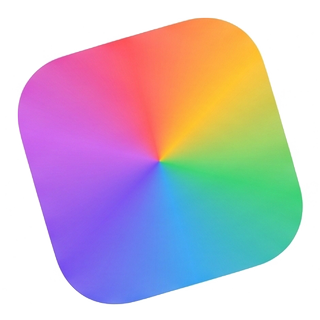

# Palette OS ✦ Autonomous Color Space Architecture

> *"Coolors makes palettes. Palette OS shows whether they work in real interfaces."*



Palette OS is an autonomous color space and interface design platform engineered for product teams, design systems architects, and UI/UX engineers. It replaces guesswork with perceptual uniformity, live component verification, and instant production token handoff.

---

## ✨ Features

- **Perceptually Uniform Lightness (OKLCH)**: Maintains optical luminance across all generated steps, eliminating murky yellows and blinding blues.
- **Real-Time WCAG 2.2 AAA & APCA Guardrails**: Live contrast auditing (`7.8:1 AAA`, `4.5:1 AA`) with real-time pass/fail badges.
- **Color-Blindness Simulation**: Built-in SVG matrix shaders for Protanopia, Deuteranopia, Tritanopia, and Monochromacy.
- **Living UI Component Proving Ground**: Preview dynamic palettes on real buttons, analytics cards, badges, and graphs in Light & Dark modes.
- **Production Token Handoff**: 1-click export to CSS Custom Properties, Tailwind config, and Figma Tokens Studio JSON.
- **Cinematic Responsive Design**: Editorial typography (`Instrument Serif`, `Plus Jakarta Sans`, `Inter`), 3D depth carousel, and ambient color dynamics.

---

## 🚀 Quickstart & Local Host

No dependencies required! Palette OS runs on pure Node.js standard libraries.

### 1. Clone the repository
```bash
git clone https://github.com/RAF3YX0X0/palette-os.git
cd palette-os
```

### 2. Start the local server
```bash
npm start
```
*Or directly with node:*
```bash
node server.js
```

### 3. Open in your browser
Navigate to:
```
http://localhost:3005/
```

---

## 📁 Project Structure

```
palette-os/
├── index.html        # Main landing page & application markup
├── style.css         # Design tokens, layouts, glassmorphism, & animations
├── app.js            # Color math, live component binding, & preview engine
├── server.js         # Lightweight Node.js static server with video streaming support
├── assets/           # High-resolution artwork, icons, & video assets
└── Palette OS.md     # Architecture specifications & design overview
```

---

## 📄 License

MIT © [RAF3YX0X0](https://github.com/RAF3YX0X0)
